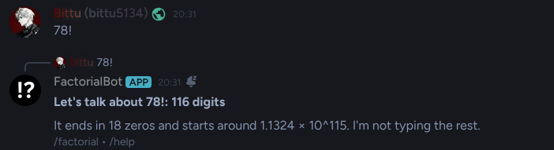

<div align="center">


# FactorialBot

**A Discord bot that answers every factorial (`10!`) in chat, whether you asked or not.**

[](https://discord.com/oauth2/authorize?client_id=1572984961030422610&permissions=68608&integration_type=0&scope=applications.commands+bot)
[](https://bittu.dev/discord/)

</div>

## How It Works

- The bot reads every message it can see, in every channel, unless you
  whitelist a few with `/setting`.
- Anything shaped like `10!` or `9!!` gets a reply, in plain text, with attitude.
- Small factorials are printed in full: `10! = 3,628,800`.
- Big ones get the digit count, the trailing zeros and a scientific shrug,
  because nobody needs 158 digits in chat.
- One reply per message, and one reply every few seconds per channel.



## Commands

- `/help` — what the bot does, plus invite and support buttons.
- `/setting` *(Manage Server)* — whitelist the channels the bot may answer in.
  Select all / clear, or pick them by hand. Nothing picked means every channel.
- `/factorial` — demand a specific factorial, with attitude.

> [!NOTE]
> You don't have to use `/factorial` at all: any message containing something
> that looks like a factorial gets a reply on its own.

## Quickstart

You can [invite the public bot](https://discord.com/oauth2/authorize?client_id=1572984961030422610&permissions=68608&integration_type=0&scope=applications.commands+bot), or host it yourself:

```bash
# Installation
git clone https://github.com/Bittu5134/FactorialBot.git && cd FactorialBot
python -m venv .venv && source .venv/bin/activate
pip install -r requirements.txt

# Configuration
# Don't forget to add your DISCORD_TOKEN here
cp .env.example .env

# Start the bot
python main.py
```

Then run `/setting` in your server if you only want it answering in a few channels.

> [!IMPORTANT]
> The bot needs the **Message Content** privileged intent. Enable it in the
> [Discord Developer Portal](https://discord.com/developers/applications) under
> **Bot → Privileged Gateway Intents**, otherwise Discord will not let it read
> messages and it will refuse to start.

### ENV Variables

Only two, and both are optional except the token:

- `DISCORD_TOKEN` — Discord bot token.
- `LOG_WEBHOOK_URL` — Optional webhook that receives guild join/leave logs.

Everything else — reply cooldown, promo chance, tracked database path, dev
guild id — lives in [`scripts/config.py`](./scripts/config.py) as plain
constants. Edit and restart.

## Support

FactorialBot is free and runs on caffeine. If it made you smile, you can
[become a patron](https://www.patreon.com/c/LazyBittu).

## Built Using

[discord.py](https://github.com/Rapptz/discord.py) · [aiosqlite](https://github.com/omnilib/aiosqlite)
